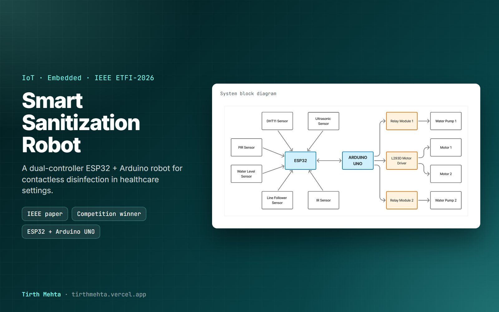
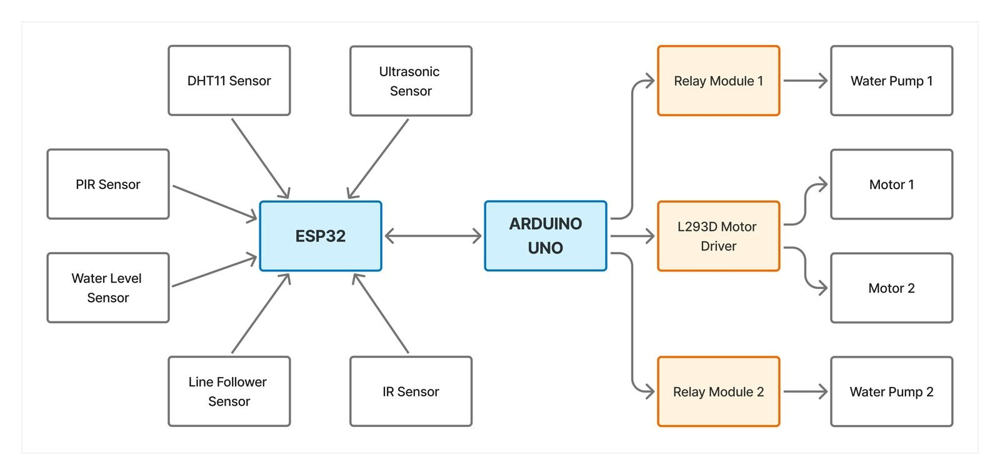

# Smart Sanitization Robot



Firmware for a **dual-controller IoT robot for contactless disinfection** in healthcare settings. An **ESP32** runs a Wi-Fi access point, a web control page and the sensors. It sends commands over a serial link to an **Arduino UNO**, which drives the motors and the spray pumps.

> Paper: *Design and Implementation of a Dual-Controller IoT-Enabled Smart Sanitization Robot for Healthcare Environments*, presented at **ETFI-2026** (IEEE Pune Section & DES Pune University).
> **Winner**, Project Competition on Embedded Systems and AI/Robotics, Dept. of IT, MPSTME, SVKM's NMIMS (28 Oct 2025).
> Team: Tirth Mehta, Krimy Shah, Dhara Patel, Mohnish Badlani, Shreyas Lapalikar.
> Portfolio page: https://tirthmehta.vercel.app/projects/smart-sanitization-robot/

## System



| Controller | Responsibilities |
|---|---|
| **ESP32** | Wi-Fi soft access point and web server (`/` control page, `/cmd` endpoint). Three HC-SR04 ultrasonic sensors (front / left / right), two IR sensors and a water-level sensor. Forwards drive and pump commands to the UNO over `Serial2` (9600 baud, GPIO 16/17). |
| **Arduino UNO** | Motor driver for two DC motors (PWM speed control), and two relay-switched water pumps. Executes single-character commands: `F` `B` `L` `R` `S` to drive, `P` / `p` for pumps on / off. |

Splitting the work this way means networking on the ESP32 never stalls motor control on the UNO.

## Repository layout

```
robo_final/
  esp_code/esp_code.ino      final ESP32 firmware (Wi-Fi AP, web page, sensors, serial bridge)
  uno_code/uno_code.ino      final Arduino UNO firmware (motors + pumps)
A UNO/                       UNO development sketches (tyres, pumps, ESP link)
HC-SR04/ IR/ pir/ DHT11/     one sketch per sensor, built up one at a time
allsensors/ 7sensors/ ...    sensor-integration steps
```

The step-by-step sketches are kept on purpose. They show the real development history, one sensor at a time, up to the final integrated firmware.

## Build and flash

1. Install the Arduino IDE with the **ESP32 board package**.
2. Flash `robo_final/uno_code/uno_code.ino` to the Arduino UNO.
3. Set your own Wi-Fi access-point password in `robo_final/esp_code/esp_code.ino` (the repo ships a placeholder), then flash it to the ESP32.
4. Wire ESP32 `TX2 (17)` → UNO `RX`, ESP32 `RX2 (16)` ← UNO `TX` (through a level shifter), and share ground.
5. Connect to the robot's Wi-Fi and open the IP printed on the ESP32 serial monitor.

## Hardware

ESP32 · Arduino UNO · HC-SR04 ultrasonic ×3 · IR ×2 · water-level sensor · DHT11 · PIR · L298N / L293D motor driver · 2 DC motors · relay module · 2 water pumps
